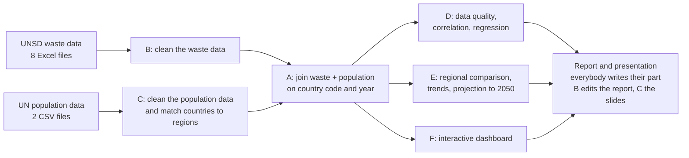

# Team 2 — Smart Waste Analytics & Demographics

Teamwork project for the Data Analysis course.

Team members:

- Boakye Anthony
- Bouattour Rayen
- Birkás Levente
- Elkerch Mohamed Amine
- Islam Md Shajedul
- Yusupov Abbosbek

## Objective

Investigate how waste generation and waste-management patterns relate to population development.

Indicators to model:

- Municipal waste generation
- Recycling
- Incineration
- Landfilling
- Historical population growth
- Future demographic projections

## Deliverables

- This GitHub repository
- Project report (format to be confirmed with the teacher)
- Presentation

## Data sources

| Source | What we use | Where it is |
| --- | --- | --- |
| UNSD Environmental Indicators, Waste Data | Municipal waste collected (2001–2023), recycling percent (2001–2024), waste treatment shares (latest year) | `team2_waste_data/raw/unsd/` |
| UN Population Division, World Population Prospects 2024 | Population and growth rate per country, 1950–2100 (Medium variant) | `team2_waste_data/raw/unpop/` |

Source URLs, download dates, units and known problems in the files are in `team2_waste_data/README.md`. To download everything again: `python team2_waste_data/scripts/download_data.py`.

## Technical requirements

- Script ingestion and transformation in Python.
- Use Pandas, NumPy, or similar tools where appropriate.
- Do not use manual Excel edits as the main transformation method.
- Match differing country names and country codes in code.
- Make the project reproducible from the code plus raw-data instructions.
- Keep a clean commit history and use Git branches.
- Document code with comments and docstrings.

## Research questions to choose from

- How does population growth affect municipal waste generation?
- Which waste-management methods are becoming more common?
- Are population projections associated with future increases in waste?
- Do recycling, incineration, or landfilling patterns differ between regions?

Pick and write down the exact question before modelling.

## Pipeline: who does what

The data goes through the project in this order. The letters are the work packages in `WORK_SPLIT.md`, where you can see who has which letter.



| Step | Package | Takes | Produces |
| --- | --- | --- | --- |
| 1. Collect | A (done) | UN websites | Raw files in `team2_waste_data/raw/`, never edited by hand |
| 2a. Clean waste | B | 3 of the UNSD Excel files | Clean CSVs: waste collected per country and year, recycling percent per country and year, treatment shares (latest year) |
| 2b. Clean population | C | The 2 WPP population files | Clean CSVs: population and growth rate per country and year (1950–2100), country → region lookup |
| 3. Join | A | B's and C's CSVs | One table, one row per country and year, with waste per person and region. Plus a script that reruns steps 2–3 with one command |
| 4a. Analyse population vs waste | D | The joined table | Notebook: data quality, correlation, regression, with charts and explanations |
| 4b. Analyse waste management | E | The joined table | Notebook: recycling / incineration / landfilling by region, recycling trend, waste projection to 2030 and 2050 |
| 4c. Dashboard | F | The joined table | Interactive Plotly dashboard (map, country picker, region comparison) |
| 5. Report and slides | Everybody | Results of steps 2–4 | Each person writes their report section and 2 slides. B puts the report together, C the presentation |

Steps 2a and 2b run at the same time. D, E and F can start with B's and C's first rough files and switch to the joined table when it is ready.

## Grading

| Area | Weight |
| --- | --- |
| Data engineering and pipeline | 30% |
| Analytical depth and modelling | 30% |
| Dashboard and visualization | 20% |
| Code quality and collaboration | 20% |

## Suggested layout

```
smart-waste-analytics/
  README.md
  WORK_SPLIT.md        who does what
  team2_waste_data/    raw downloads (unchanged), download script, source notes
  data/processed/      cleaned and joined tables (created by the code, not committed)
  notebooks/           cleaning, analysis and modelling notebooks
  src/                 .py versions of cleaning and joining, if someone prefers scripts
  dashboard/           interactive dashboard
  outputs/             figures and exported dashboard (created by the code)
  report/              project report
  presentation/        slides
```

## Who does what

The split is in `WORK_SPLIT.md`: six packages (A–F), one per person. Each package is code + a report section + 2 slides. Do not edit the raw data files by hand.

## How we work with Git

- Work on your own branch, for example `feature/rayen-waste-cleaning`.
- When your part is ready, open a pull request. A reviews it and merges it into `main`.
- Only you edit your own notebook. Two people in the same notebook cause conflicts that are hard to fix.
