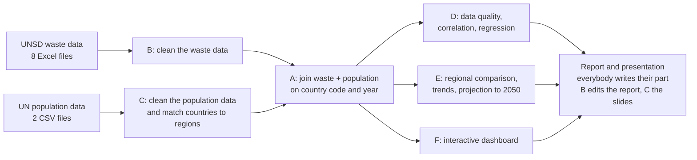

# Team 2 — Smart Waste Analytics & Demographics

Teamwork project for the Data Analysis course.

Team members:

- Boakye Anthony
- Bouattour Rayen
- Birkás Levente
- Elkerch Mohamed Amine
- Islam Md Shajedul
- Yusupov Abbosbek

## Objective

Investigate how waste generation and waste-management patterns relate to population development.

Indicators to model:

- Municipal waste generation
- Recycling
- Incineration
- Landfilling
- Historical population growth
- Future demographic projections

## Deliverables

- This GitHub repository
- Project report (format to be confirmed with the teacher)
- Presentation

## Data sources

| Source | What we use | Where it is |
| --- | --- | --- |
| UNSD Environmental Indicators, Waste Data | Municipal waste collected (2001–2023), recycling percent (2001–2024), waste treatment shares (latest year) | `team2_waste_data/raw/unsd/` |
| UN Population Division, World Population Prospects 2024 | Population and growth rate per country, 1950–2100 (Medium variant) | `team2_waste_data/raw/unpop/` |

Source URLs, download dates, units and known problems in the files are in `team2_waste_data/README.md`. To download everything again: `python team2_waste_data/scripts/download_data.py`.

## Technical requirements

- Script ingestion and transformation in Python.
- Use Pandas, NumPy, or similar tools where appropriate.
- Do not use manual Excel edits as the main transformation method.
- Match differing country names and country codes in code.
- Make the project reproducible from the code plus raw-data instructions.
- Keep a clean commit history and use Git branches.
- Document code with comments and docstrings.

## Research questions to choose from

- How does population growth affect municipal waste generation?
- Which waste-management methods are becoming more common?
- Are population projections associated with future increases in waste?
- Do recycling, incineration, or landfilling patterns differ between regions?

Pick and write down the exact question before modelling.

## Pipeline: who does what

The data goes through the project in this order. The letters are the work packages in `WORK_SPLIT.md`, where you can see who has which letter.



| Step | Package | Takes | Produces |
| --- | --- | --- | --- |
| 1. Collect | A (done) | UN websites | Raw files in `team2_waste_data/raw/`, never edited by hand |
| 2a. Clean waste (done) | B | 3 of the UNSD Excel files | `cleaning_waste_datasets.ipynb` → `municipal_waste_collected_clean.csv`, `municipal_waste_recycled_pct_clean.csv`, `municipal_waste_treatment_latest_clean.csv` |
| 2b. Clean population (done) | C | The 2 WPP population files | `cleaning_population.ipynb` → `population_clean.csv` (1950–2100), `country_region_lookup.csv`, `population_unmatched_countries.csv` |
| 3. Join (done) | A | B's and C's CSVs | `merging_datasets.ipynb` → `panel_country_year.csv`, `treatment_latest_joined.csv`. Plus `run_pipeline.py`, which reruns steps 2–3 with one command |
| 4a. Analyse population vs waste | D | `panel_country_year.csv` | Notebook: data quality, correlation, regression, with charts and explanations |
| 4b. Analyse waste management | E | `panel_country_year.csv`, `treatment_latest_joined.csv`, `population_clean.csv` | Notebook: recycling / incineration / landfilling by region, recycling trend, waste projection to 2030 and 2050 |
| 4c. Dashboard | F | `panel_country_year.csv`, `treatment_latest_joined.csv`, `population_clean.csv` | Interactive Plotly dashboard (map, country picker, region comparison) |
| 5. Report and slides | Everybody | Results of steps 2–4 | Each person writes their report section and 2 slides. B puts the report together, C the presentation |

The notebooks are in `team2_waste_data/scripts/`, all CSVs in `team2_waste_data/processed/`.

## Which file to use (D, E, F)

| File | One row per | Use it for |
| --- | --- | --- |
| `panel_country_year.csv` | country and year, 2001–2024 | Waste vs population: `Waste_Collected_1000t`, `Recycled_Pct`, `Population_1000`, `Growth_Rate_Pct`, `Waste_kg_per_capita`, `Region`, `ISO3` (for maps) |
| `treatment_latest_joined.csv` | country (its latest reported year) | Landfill / incineration / recycling / composting shares by country or region |
| `population_clean.csv` | country and year, 1950–2100 | Population projections (`Is_Projection` = True after 2023) |
| `country_region_lookup.csv` | country | Country → sub-region → region |

Things to know before you analyse:
- Many country-years have no waste value (about 19% of the panel rows have no waste collected, 41% no recycling percent). Check coverage before comparing years or regions.
- Some waste-per-person values are unrealistic (for example DR Congo over 6,000 kg, Viet Nam near 0). They are not removed; D decides how to treat them.
- Treatment shares: use `Shares_Quality == "complete"` when the shares must add up to 100%. Eurostat countries are `incomplete` because the UN table leaves out incineration with energy recovery. OECD countries (USA, Japan, UK, …) are `invalid`, and their shares are empty because the source file has a unit problem. Details are in `merging_datasets.ipynb`.
- Sudan (Former) and Kosovo have no population data and are not in the joined tables.

## How to reproduce

From the repository root:

```bash
pip install -r requirements.txt
python run_pipeline.py
```

This runs the three data notebooks in order (B → C → A) and rebuilds every CSV in `team2_waste_data/processed/` from the raw files in `team2_waste_data/raw/`. The notebooks themselves are not changed. To download the raw files from the UN websites again first, run `python run_pipeline.py --download`.

You can also open the notebooks in Jupyter and run them one by one (Kernel → Restart & Run All), in the same order.

## How to open the dashboard

The dashboard is a [Streamlit](https://streamlit.io) app (`dashboard/app.py`) built with Plotly. It runs in your web browser and needs no coding: you only use the slider and the drop-down menus.

**You need:** Python 3.10 or newer (3.12 or 3.13 is the safest choice) and an internet connection for the first install.

**Steps** (run every command from the repository root, the folder that contains `run_pipeline.py`):

1. Install the packages for the whole project and for the dashboard:
   ```
   pip install -r requirements.txt
   pip install -r dashboard/requirements.txt
   ```
2. (Optional) Rebuild the data tables. They are already in `team2_waste_data/processed/`, so you can skip this step:
   python run_pipeline.py
   ```
   python run_pipeline.py
   ```
3. Start the dashboard:
   ```
   streamlit run dashboard/app.py
   ```
4. Your browser opens at `http://localhost:8501`. If it does not, open that address yourself. To stop the dashboard, press `Ctrl+C` in the terminal.

On Windows, if `pip`, `python` or `streamlit` is "not recognized", put `py -m` in front: `py -m pip install -r requirements.txt` and `py -m streamlit run dashboard/app.py`.

**What you can do in the dashboard**

| Section | What it shows | What you can do |
| --- | --- | --- |
| 1. World map | Municipal waste collected per person (kg per person per year) | Move the year slider; hover over a country |
| 2. One country over time | Waste per person and population for one country | Pick a country from the list |
| 3. Treatment by region | Share of waste that is recycled, composted, incinerated, landfilled or treated otherwise (%) | Hover over the bars |
| 4. Population until 2100 | Population by region, million people (dashed = UN projection) | Choose which regions to show |

Grey countries on the map did not report waste data for that year. Only countries whose treatment shares add up to about 100% are used in section 3.

**Problems and fixes**

| Message or problem | What to do |
| --- | --- |
| `FileNotFoundError ... panel_country_year.csv` | Step 2 was skipped: run `python run_pipeline.py` from the repository root. |
| `Error: Invalid value: File does not exist: dashboard/app.py` | You are in the wrong folder. Go to the repository root with `cd` and try again. |
| `An Application Control policy has blocked this file` (Windows, pandas) | A very new pandas version is blocked. Install an older one: `pip install "pandas==2.3.3"`, then start the dashboard again. |
| Port 8501 is already in use | Close the other dashboard window, or run `streamlit run dashboard/app.py --server.port 8502`. |


## Grading

| Area | Weight |
| --- | --- |
| Data engineering and pipeline | 30% |
| Analytical depth and modelling | 30% |
| Dashboard and visualization | 20% |
| Code quality and collaboration | 20% |

## Folder layout

```
smart-waste-analytics/
  README.md
  WORK_SPLIT.md            who does what
  requirements.txt         Python packages for the whole project
  run_pipeline.py          rebuilds all cleaned and joined data with one command
  team2_waste_data/
    README.md              detailed notes on every raw file (sources, units, known problems)
    raw/                   original downloads, never edited by hand
    scripts/               download script + data notebooks (cleaning, joining)
    processed/             cleaned and joined CSVs (committed, so you can use them without running anything)
    sources/               snapshot of the UNSD web page
  outputs/                 figures and exported dashboard (created by the code, not committed)
  report/                  project report
  presentation/            slides
```

Analysis notebooks (D, E) and the dashboard (F) can go in `team2_waste_data/scripts/` next to the others, or in a new `notebooks/` / `dashboard/` folder. Just read the CSVs from `team2_waste_data/processed/`.

## Who does what

The split is in `WORK_SPLIT.md`: six packages (A–F), one per person. Each package is code + a report section + 2 slides. Do not edit the raw data files by hand.

## How we work with Git

- Work on your own branch, for example `feature/rayen-waste-cleaning`.
- When your part is ready, open a pull request. A reviews it and merges it into `main`.
- Only you edit your own notebook. Two people in the same notebook cause conflicts that are hard to fix.
